# K-Nearest Neighbors Projects

Two end-to-end KNN projects, each as a standalone, leakage-free Python script:

1. **Classification:** credit card fraud detection with scikit-learn and imbalanced-learn (`knn_classification.py`).
2. **Regression:** concrete compressive strength prediction with scikit-learn (`knn_regression.py`).

Both scripts split the data first, fit every preprocessing step on training data only, tune hyperparameters (and, for classification, the decision threshold) without touching the test set, and use the test set exactly once at the end. They save all figures to `outputs/`.

---

## Project 1: Credit Card Fraud Detection (Classification)

**Script:** `knn_classification.py`
**Dataset:** `creditcard.csv`, 284,807 transactions, 492 of them fraud (0.173 %). Features are `Time`, `Amount`, and 28 anonymised PCA components `V1` to `V28`.

> `creditcard.csv` is about 150 MB, which is over GitHub's 100 MB file limit, so it is **not stored in Git**. It is versioned with [DVC](https://dvc.org) (see `creditcard.csv.dvc`). Get it either with `dvc pull` (from the DagsHub copy of this repository) or by downloading it from [Kaggle: Credit Card Fraud Detection](https://www.kaggle.com/datasets/mlg-ulb/creditcardfraud) and placing it in this folder.

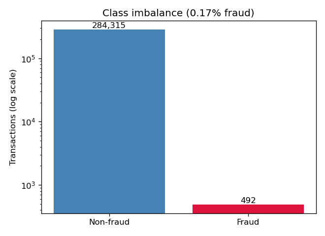

### Methodology

1. **Split first:** stratified 70/30 train/test split before any modelling. The training set is split again (80/20) into a *fit* part and a *validation* part. Every decision below is made on the validation part, and the test set is scored once at the end.
2. **Baseline (A):** `StandardScaler` → `PCA(15)` → `SMOTE` (fraud = 100 % of non-fraud) → KNN with `k = 7`, distance weights, decision threshold 0.5.
3. **Why the baseline has low precision:** SMOTE balances the training classes 1:1, which inflates the predicted fraud probabilities, so a fixed 0.5 cut-off raises far too many false alarms.
4. **Variants compared on the validation split:**

   | Variant | Change |
   |---|---|
   | B | baseline model, with `k`, weighting and the **decision threshold tuned** |
   | C | B without SMOTE |
   | D | B with light SMOTE (fraud = 10 % of non-fraud) |
   | E1 / E2 | C with `Time` dropped and `log(Amount)`, with PCA(15) / without PCA |

   `k` ∈ {3, 5, 7, 11, 15, 25, 40} and weights ∈ {uniform, distance} are all read off one neighbour search per variant, so the grid is cheap. The threshold is the one that maximises F1 on the validation split.
5. **Final model:** the variant with the best validation PR-AUC is refit on the full training set and evaluated once on the test set, next to the baseline. ROC-AUC and PR-AUC use predicted probabilities.

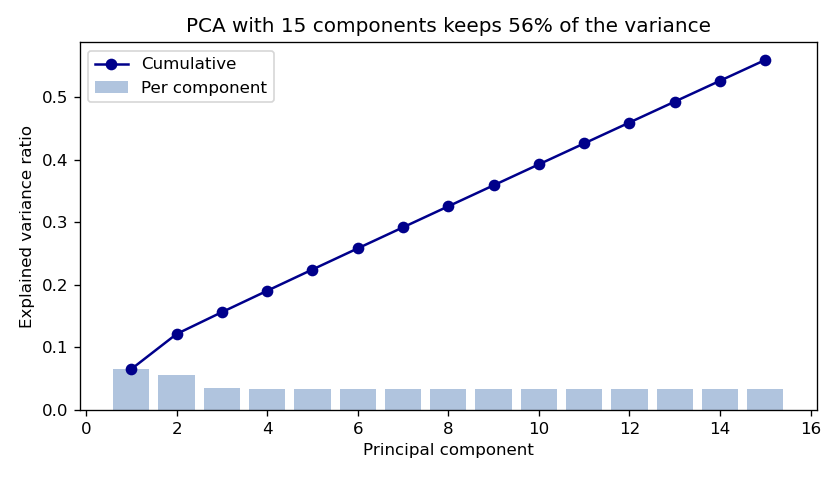

### Validation comparison (39,873 rows, 69 frauds)

Thresholds are tuned on this same split, so rows B to E are slightly optimistic. Treat small differences as noise.

| Variant | PR-AUC | Precision | Recall | F1 |
|---|---|---|---|---|
| A: baseline (threshold 0.5) | 0.627 | 0.434 | 0.913 | 0.589 |
| B: SMOTE 1:1, tuned threshold | 0.699 | 0.760 | 0.826 | 0.792 |
| C: no SMOTE | 0.886 | 0.933 | 0.812 | 0.868 |
| D: light SMOTE (0.1) | 0.861 | 0.906 | 0.841 | 0.872 |
| E1: C, no `Time`, log `Amount`, PCA 15 | 0.871 | 0.951 | 0.841 | 0.892 |
| **E2: C, no `Time`, log `Amount`, no PCA** | **0.889** | 0.982 | 0.797 | 0.880 |

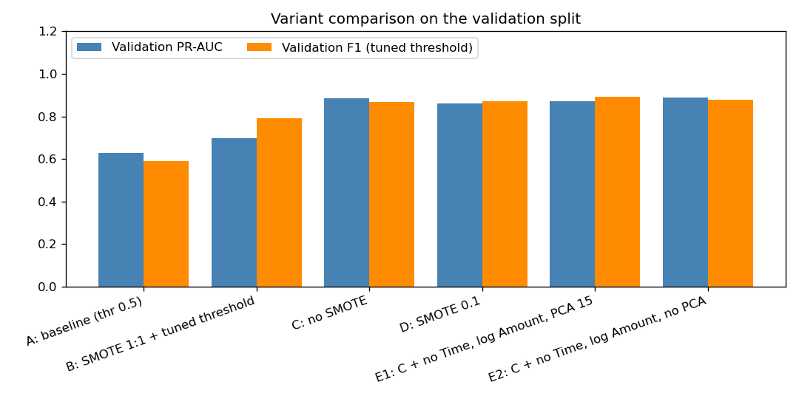

Selected: **E2** (`k = 40`, distance weights, threshold 0.725). C, D, E1 and E2 are within noise of each other. What clearly matters is dropping or reducing SMOTE and tuning the threshold.

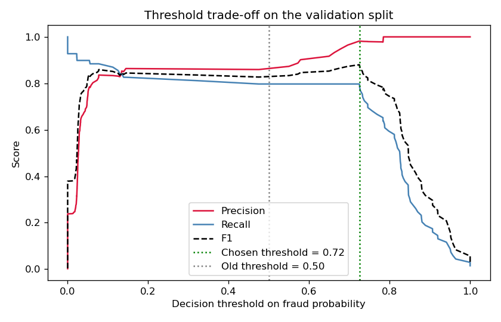

### Results (test set, 85,443 transactions, 148 frauds)

| Metric | Before (baseline A) | After (E2) |
|---|---|---|
| Fraud precision | 0.309 | **0.981** |
| Fraud recall | 0.824 | 0.682 |
| Fraud F1 | 0.449 | **0.805** |
| PR-AUC | 0.480 | **0.811** |
| ROC-AUC | 0.918 | 0.922 |
| False alarms (non-fraud flagged) | 273 | **2** |
| Frauds caught | 122 of 148 | 101 of 148 |

Confusion matrix of the final model:

| | Predicted non-fraud | Predicted fraud |
|---|---|---|
| **Actual non-fraud** | 85,293 | 2 |
| **Actual fraud** | 47 | 101 |

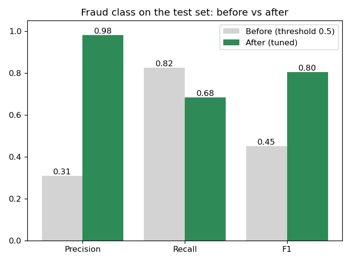

<p align="center">
  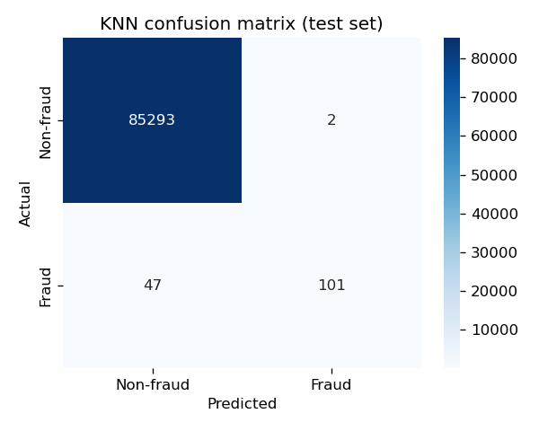
  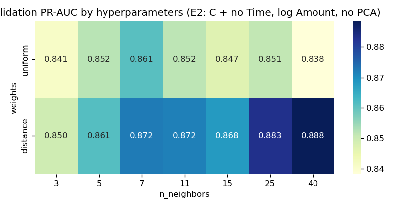
</p>
<p align="center">
  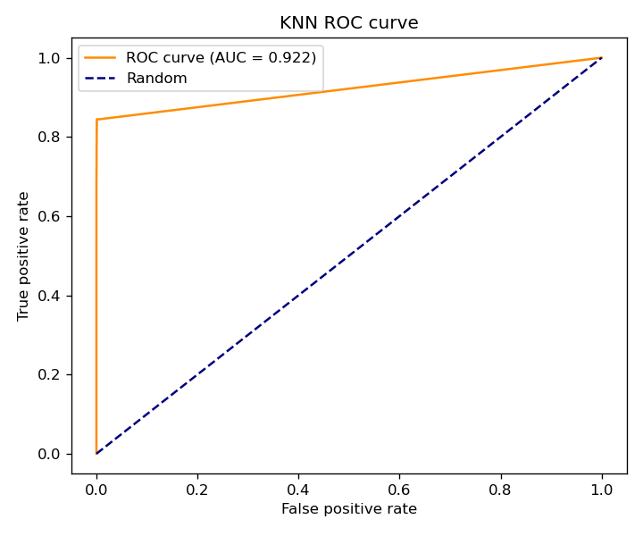
  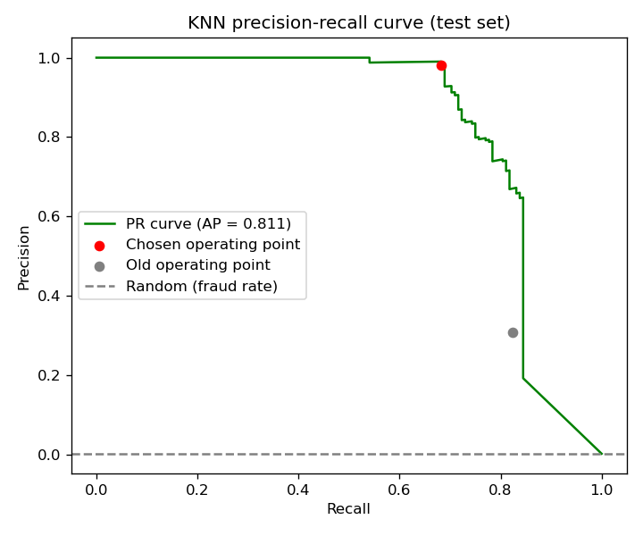
</p>

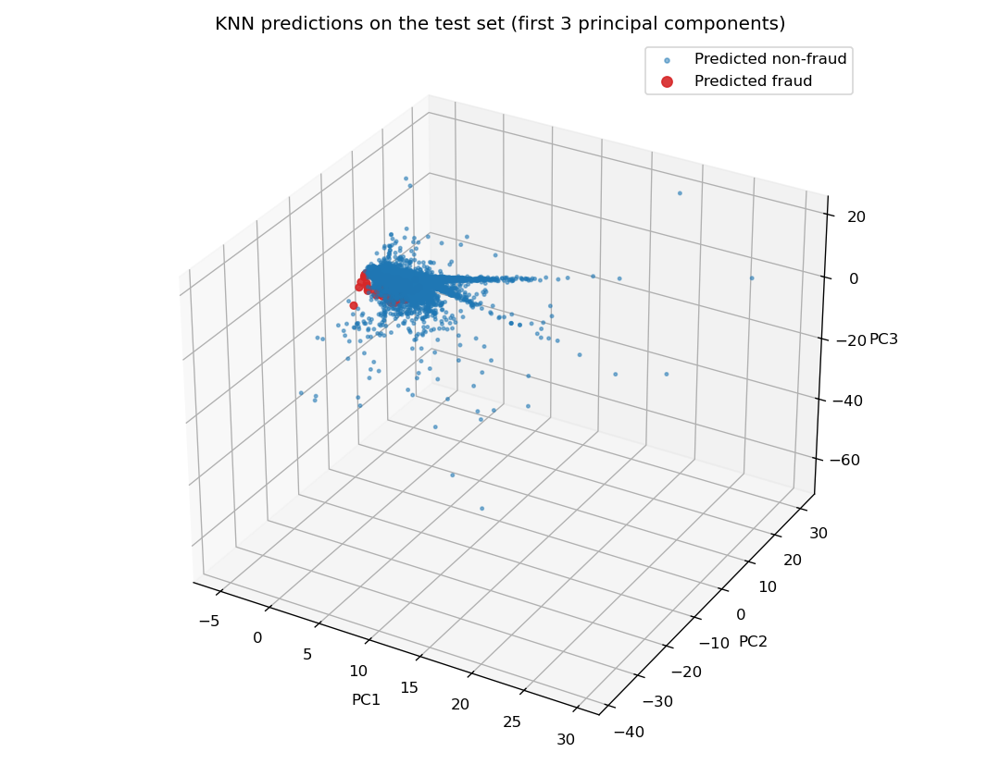

### Key Findings

- **Precision rose from 0.31 to 0.98 and PR-AUC from 0.48 to 0.81**, with 2 false alarms instead of 273. The gain comes from not over-balancing the classes with SMOTE and from choosing the decision threshold on validation data.
- **This is a trade-off, not a free win:** recall fell from 0.82 to 0.68 (47 frauds missed instead of 26). The F1-optimal threshold favours precision. If missing a fraud costs much more than a false alarm, choose a lower threshold. The alternative operating point printed by the script (threshold 0.030, picked for validation precision of at least 0.6) gives test precision 0.498 and recall 0.845 with 251 alerts. Note that validation promised precision of at least 0.6 but the test set gave 0.50, because the validation split holds only 69 frauds.
- **Small sample warning:** the test set has only 148 frauds, so a difference of a few frauds changes recall by several points. Treat these numbers as indicative.
- **Accuracy is misleading** here: always predicting "non-fraud" scores 99.83 %.
- ROC-AUC barely changed (0.918 → 0.922). It ignores the huge number of non-fraud rows, so it hides the false-alarm problem that precision and PR-AUC expose.
- Brute-force neighbour search with one query per variant is much faster than the original ball-tree pipeline: the whole comparison plus the final test scoring runs in about 10 minutes.
- KNN is still not the best tool for this problem. Tree ensembles typically reach higher PR-AUC with far faster prediction, which makes this dataset a good candidate for the Random Forest and Gradient Boosting projects.

---

## Project 2: Concrete Compressive Strength (Regression)

**Script:** `knn_regression.py`
**Dataset:** `Concrete_Data.xls` ([UCI Concrete Compressive Strength](https://archive.ics.uci.edu/dataset/165/concrete+compressive+strength)), 1,030 rows, no missing values.

| Variable | Description |
|---|---|
| `cement`, `slag`, `fly_ash`, `water`, `superplasticizer`, `coarse_agg`, `fine_agg` | Ingredient amounts (kg per m³ of mixture) |
| `age` | Age of the concrete in days |
| `strength` | Compressive strength in MPa (target) |

<p align="center">
  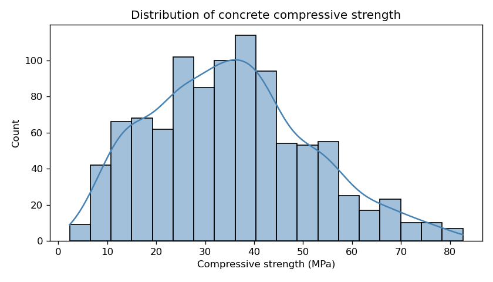
  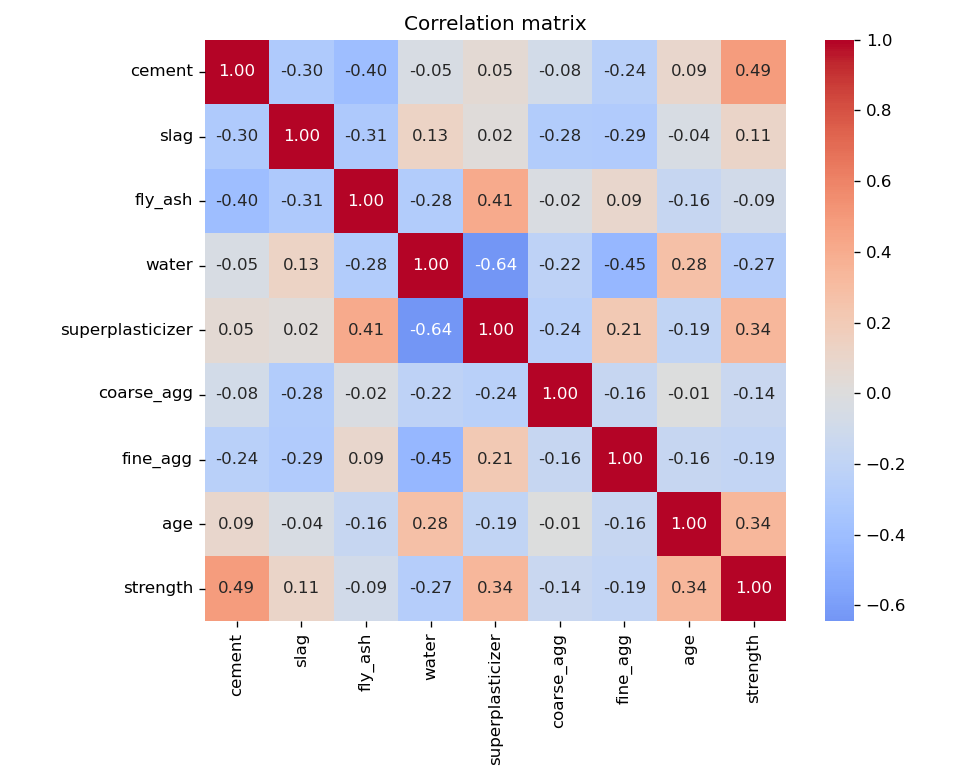
</p>

### Methodology

1. **Duplicate recipes:** 25 exact duplicate rows exist, and more rows share the same recipe and age with different strengths. These are merged into one row (mean strength), leaving 996 rows. This is done before the split so the same recipe cannot appear in both train and test.
2. **Split:** 80/20 train/test (796 / 200 rows).
3. **Outliers:** rows with any column at |z| > 3 are removed from the **training set only**, using training-set statistics (39 rows removed). The test set is never filtered.
4. **Tuning:** `StandardScaler` + `KNeighborsRegressor` in a pipeline, 5-fold CV over `n_neighbors` 1 to 20, `weights` (uniform / distance), and `p` (Manhattan / Euclidean), scored by RMSE.
5. **Outlier comparison:** both variants are re-scored on identical, unfiltered validation folds, so the comparison is fair.
6. **Final evaluation:** one pass on the held-out test set.

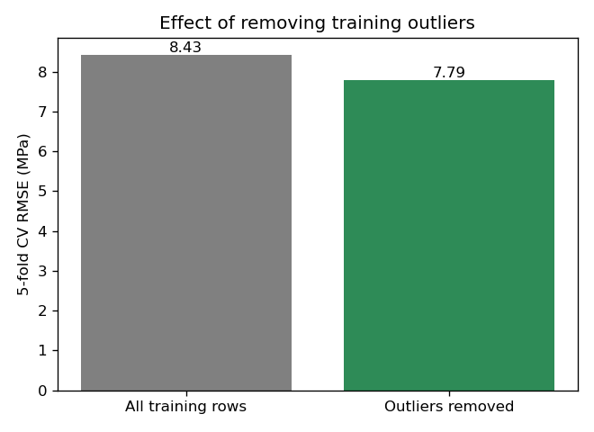

### Results

Selected model: outliers removed, `n_neighbors = 3`, `weights = distance`, `p = 2`.

| Metric | Value |
|---|---|
| CV RMSE, all training rows | 8.43 MPa |
| CV RMSE, outliers removed | 7.79 MPa |
| **Test RMSE** | **8.14 MPa** |
| Test MAE | 5.86 MPa |
| Test R² | 0.723 |

<p align="center">
  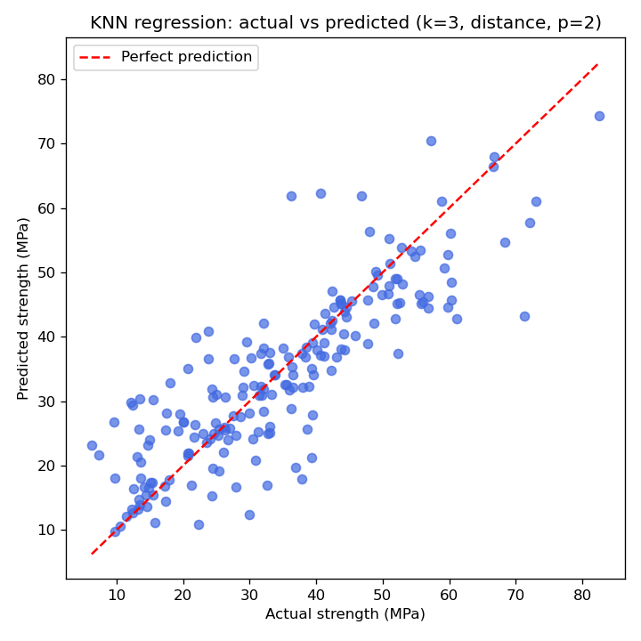
  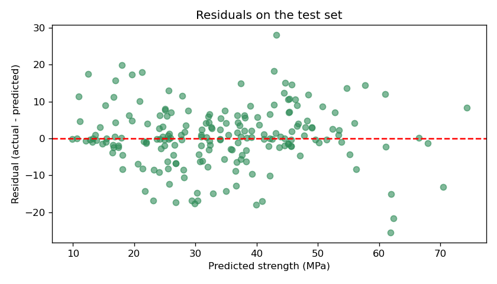
</p>
<p align="center">
  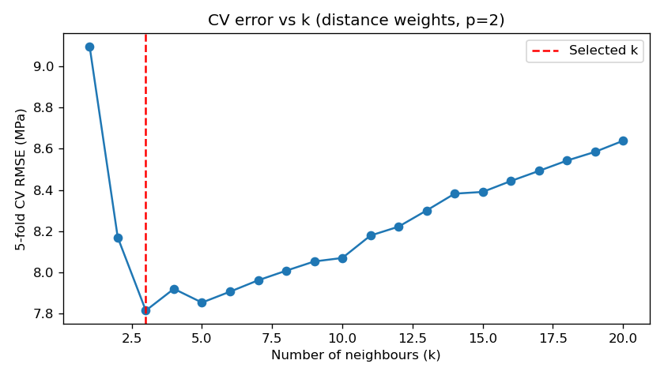
  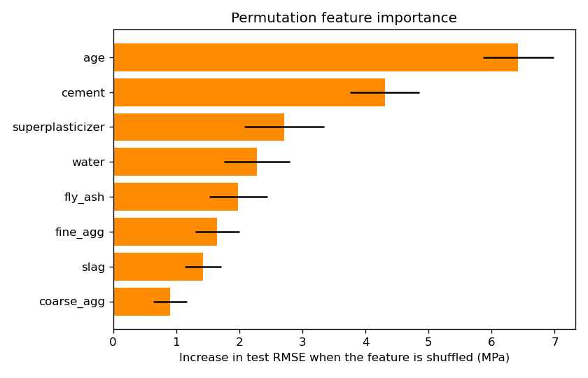
</p>

### Key Findings

- Removing training outliers lowers CV RMSE from 8.43 to 7.79 MPa, and the test RMSE (8.14) is close to the CV estimate (7.79), so the model generalises as expected.
- **Most important features** (permutation importance on the test set): `age` (+6.4 MPa RMSE when shuffled), `cement` (+4.3), `superplasticizer` (+2.7) and `water` (+2.3). `coarse_agg` matters least (+0.9).
- CV error is lowest around k = 3 to 5 and rises steadily for larger k, as expected when the neighbourhood becomes too smooth.
- **Train R² is not reported.** With distance weighting each training point is its own nearest neighbour, so train R² is always 1.0 and says nothing about overfitting. CV versus test error is the meaningful check.
- Test R² of 0.72 is moderate. Strength depends non-linearly on age and on ingredient ratios, so tree-based models would likely do better than KNN on this data.

---

## Requirements

- Python 3.9 or later
- numpy, pandas, scikit-learn, imbalanced-learn
- matplotlib, seaborn
- xlrd (to read `Concrete_Data.xls`)

```bash
pip install -r requirements.txt
```

DVC, MLflow and DagsHub are optional and only needed for the tracking features described [below](#dagshub-data-versioning-and-experiment-tracking).

## Project Structure

```
3-KNN/
├── knn_classification.py   # Credit card fraud detection (KNN, variant comparison, threshold tuning)
├── knn_regression.py       # Concrete strength prediction (KNN regressor)
├── tracking.py             # Optional MLflow / DagsHub experiment tracking (--track)
├── Concrete_Data.xls       # Concrete dataset (1,030 rows)
├── creditcard.csv.dvc      # DVC pointer to the 150 MB fraud dataset (the CSV itself is not in Git)
├── requirements.txt        # Project dependencies
├── requirements-dagshub.txt # Extra packages for DVC / MLflow / DagsHub
├── outputs/                # Figures generated by the scripts
└── README.md
```

## Usage

Run each script from this folder:

```bash
python knn_regression.py        # about a minute
python knn_classification.py    # about 10 minutes (compares 5 variants, then scores the test set)
```

Results are reproducible: all random seeds are fixed to 42. Figures are written to `outputs/`.

## DagsHub: data versioning and experiment tracking

[DagsHub](https://dagshub.com) hosts the Git repository, the DVC-versioned dataset, and MLflow experiment runs in one place.

### Track experiments (MLflow)

```bash
pip install -r requirements-dagshub.txt
```

Without any configuration, `--track` logs to a local `mlflow.db` file (view it with `mlflow ui --backend-store-uri sqlite:///mlflow.db`). To log to your DagsHub repository instead, set these environment variables first (PowerShell syntax; use a token from DagsHub under *Settings → Tokens*, and never commit it):

```powershell
$env:DAGSHUB_REPO_OWNER = "<your-dagshub-username>"
$env:DAGSHUB_REPO_NAME  = "<your-repo-name>"
$env:DAGSHUB_USER_TOKEN = "<your-dagshub-token>"

python knn_regression.py --track
python knn_classification.py --track
```

Each run logs its parameters (best `k`, weights, threshold, variant), metrics (test precision, recall, F1, PR-AUC, RMSE, R², ...) and all plots from `outputs/`. They appear on the repository's **Experiments** tab.

### Get the dataset (DVC)

After cloning from DagsHub, fetch the large file with:

```bash
pip install dvc
dvc pull
```

### Publish this folder to GitHub and DagsHub (one-time)

Run these in the VS Code terminal from the `3-KNN` folder. Replace `<user>` and `<repo>` with your own names. Create an empty repository on each site first (GitHub: *New repository*; DagsHub: *Create → New Repository*), without adding a README or license there.

```bash
# 0. Only if Git says "detected dubious ownership" (folder copied from another account):
git config --global --add safe.directory "D:/Ml Projects/Files for github/3-KNN"

# 1. Point DVC at DagsHub storage. --local keeps your token OUT of Git.
dvc remote add -d origin https://dagshub.com/<user>/<repo>.dvc
dvc remote modify origin --local auth basic
dvc remote modify origin --local user <user>
dvc remote modify origin --local password <your-dagshub-token>

# 2. Commit everything. creditcard.csv is NOT included (ignored by Git, tracked by DVC).
git add .
git status          # check: creditcard.csv must NOT be listed
git commit -m "Add KNN fraud detection and concrete strength projects"

# 3. Upload the 150 MB dataset to DagsHub storage
dvc push

# 4. Push the code
git remote add dagshub https://dagshub.com/<user>/<repo>.git
git push -u dagshub main

git remote add github https://github.com/<user>/<repo>.git
git push -u github main
```

The GitHub copy has the code, plots and the `creditcard.csv.dvc` pointer; the data itself lives on DagsHub (or Kaggle). If GitHub or DagsHub asks for a password when pushing, use a personal access token, not your account password.
